# Система тестирования знаний

Приложение для создания тестов и проверки знаний на **Flutter, Dart и Serverpod**. Объединяет инструменты автора тестов и личный кабинет участника в одном интерфейсе на русском языке.

Автор составляет тесты и варианты ответов, а участник проходит тестирование и получает результат. Данные хранятся в PostgreSQL; подсчёт баллов и выдача сертификата выполняются на сервере.

## Возможности

- Регистрация и вход, роли автора и участника.
- Каталог тестов с поиском и фильтрацией по категории.
- Создание тестов и категорий, добавление и удаление вопросов и вариантов ответов.
- Копирование собственных тестов и вопросов.
- Прохождение теста с одним правильным ответом на вопрос.
- Подсчёт баллов, процента правильных ответов и просмотр разбора попытки.
- История результатов и список сертификатов за успешно пройденные тесты.
- Проходной балл — 80% с округлением необходимого числа правильных ответов вверх.
- Защита истории: удаление вопросов и ответов, использованных в попытках, ограничено.

## Демонстрация

Скриншоты приложения на iPhone: от выбора теста до просмотра результата и разбора ответов.

### Вход и каталог

<table>
  <tr>
    <td align="center">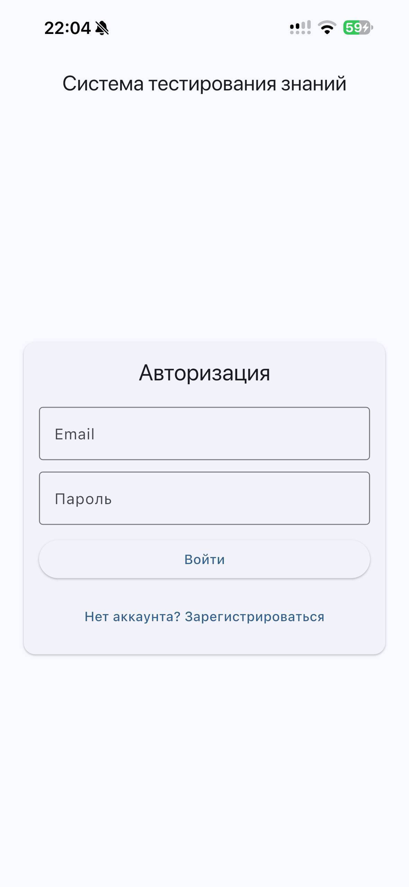<br><sub>Авторизация</sub></td>
    <td align="center">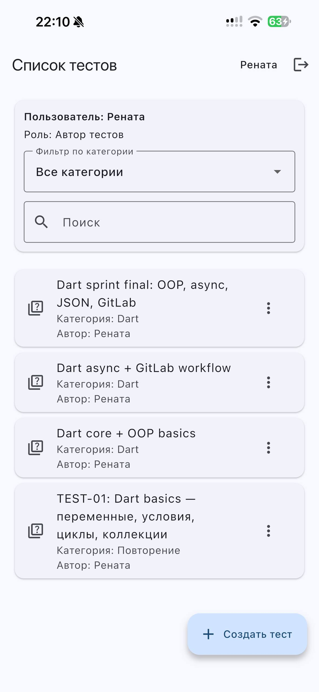<br><sub>Каталог автора</sub></td>
    <td align="center">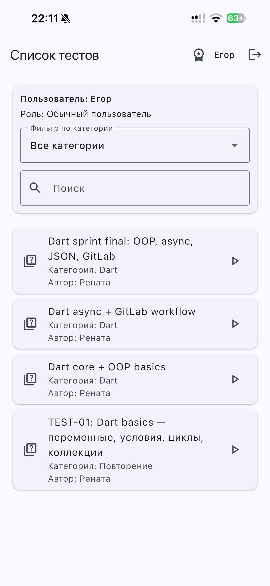<br><sub>Каталог участника</sub></td>
  </tr>
</table>

### Работа автора

Автор управляет тестами, составляет вопросы и отмечает правильные ответы.

<table>
  <tr>
    <td align="center">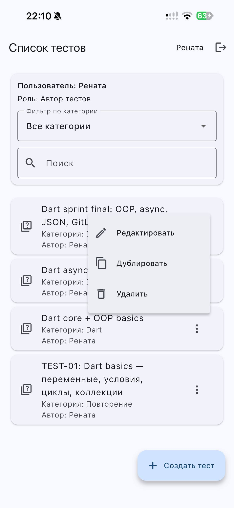<br><sub>Управление тестом</sub></td>
    <td align="center">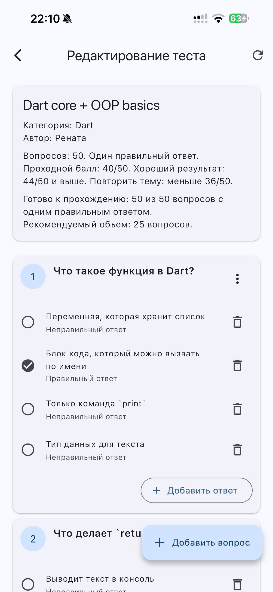<br><sub>Редактор вопросов</sub></td>
    <td align="center">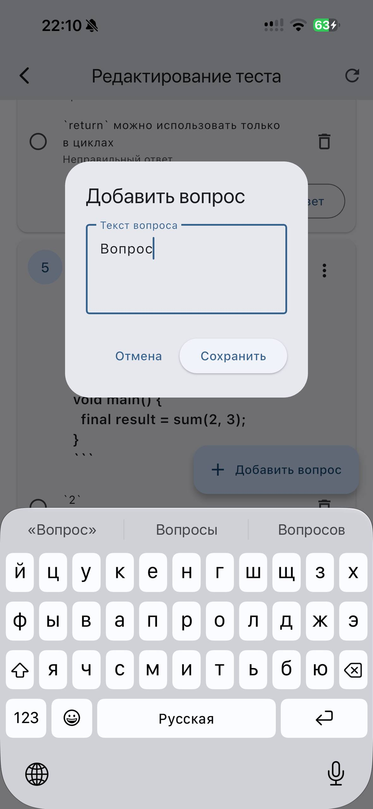<br><sub>Добавление вопроса</sub></td>
  </tr>
</table>

### Тестирование и результаты

Участник выбирает ответы, отслеживает прогресс и получает результат с разбором ошибок.

<table>
  <tr>
    <td align="center">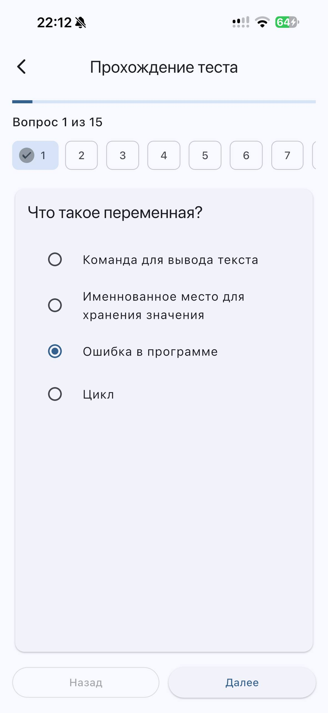<br><sub>Прохождение теста</sub></td>
    <td align="center">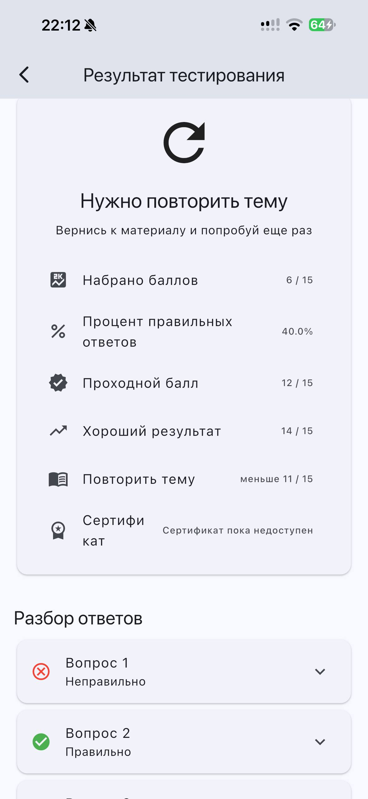<br><sub>Результат попытки</sub></td>
    <td align="center">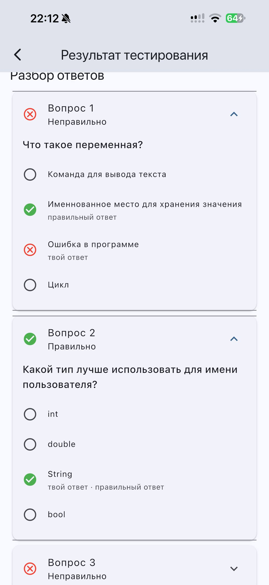<br><sub>Разбор ответов</sub></td>
  </tr>
</table>

<details>
<summary>Дополнительные экраны: сертификаты, фильтры и состояния интерфейса</summary>

<table>
  <tr>
    <td align="center">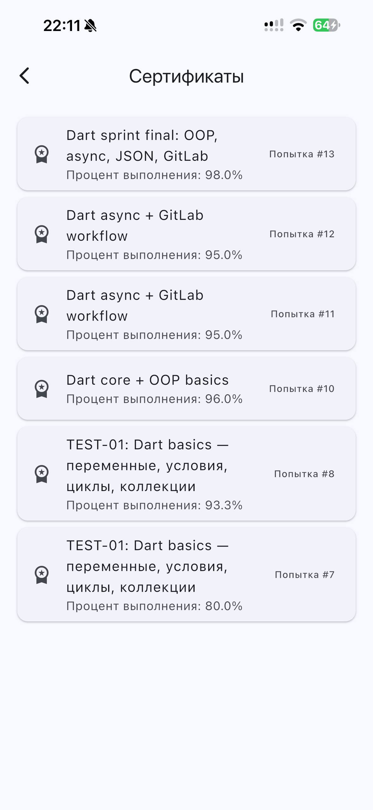<br><sub>Полученные сертификаты</sub></td>
    <td align="center">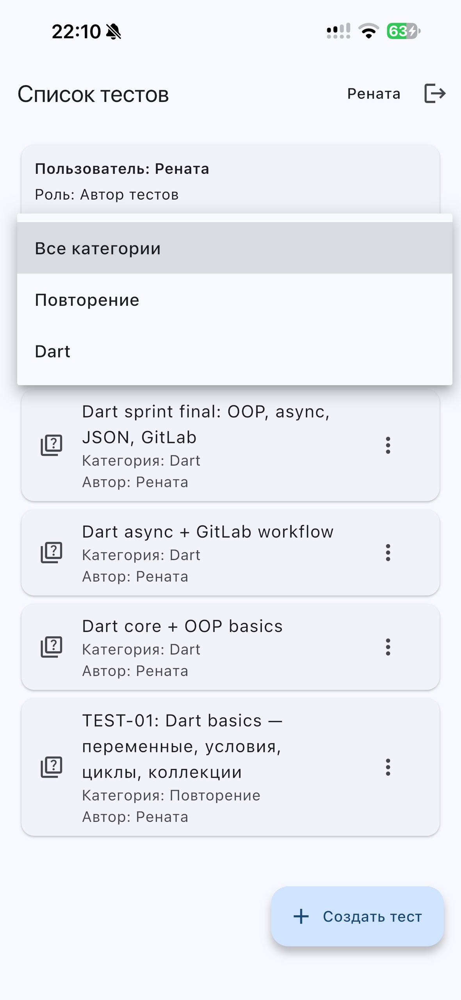<br><sub>Выбор категории</sub></td>
    <td align="center">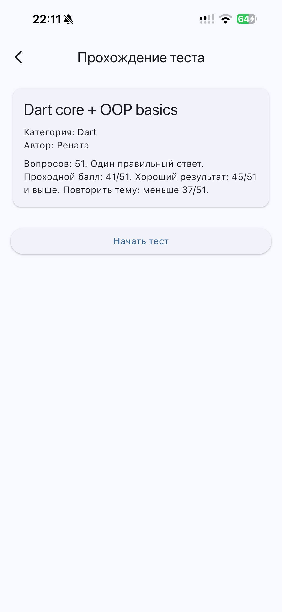<br><sub>Информация перед стартом</sub></td>
  </tr>
</table>

<table>
  <tr>
    <td align="center">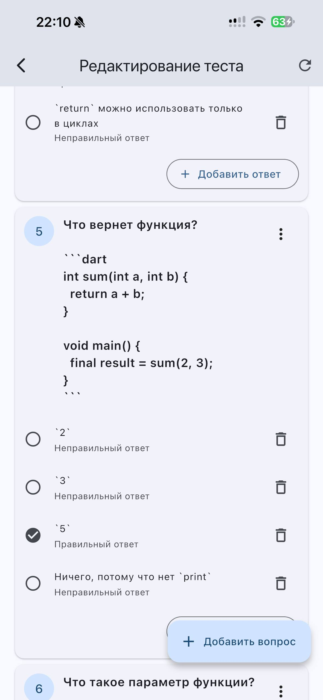<br><sub>Вопрос с примером кода</sub></td>
    <td align="center">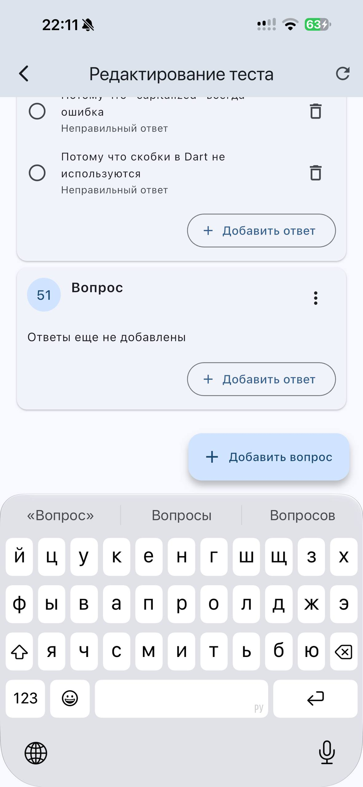<br><sub>Новый вопрос без ответов</sub></td>
    <td align="center">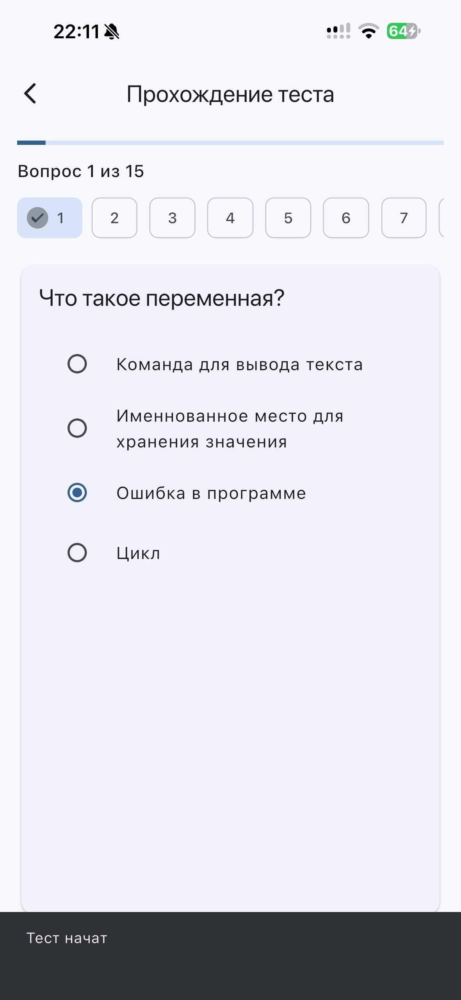<br><sub>Начало попытки</sub></td>
  </tr>
</table>

<table>
  <tr>
    <td align="center">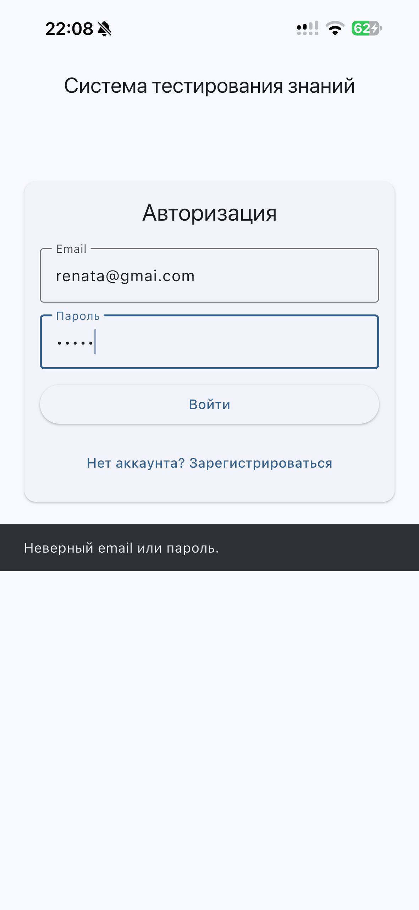<br><sub>Сообщение при неверных данных входа</sub></td>
  </tr>
</table>

</details>

## Технологии и структура

| Часть | Технологии | Каталог |
| --- | --- | --- |
| Интерфейс | Flutter, Material 3 | `knowledge_testing_app_flutter/` |
| API-клиент | Сгенерированный типизированный клиент Serverpod | `knowledge_testing_app_client/` |
| Сервер | Dart, Serverpod 3.1.1, ORM и миграции | `knowledge_testing_app_server/` |
| Хранение данных | PostgreSQL | Конфигурация в серверном каталоге |

Flutter-приложение обращается к Serverpod через API. Сервер обрабатывает пользователей, категории, тесты, вопросы, ответы, попытки, результаты и сертификаты. Основная серверная логика находится в `knowledge_testing_app_server/lib/src/endpoints/`, экраны — в `knowledge_testing_app_flutter/lib/screens/`.

## Локальный запуск

<details>
<summary>Настройка окружения, запуск сервера и приложения на iPhone</summary>

Нужны Flutter от 3.32, Dart от 3.8 и PostgreSQL. Для запуска на iPhone также нужны macOS, Xcode и настроенная подпись приложения.

Команды ниже выполняются из корня репозитория, если не указан другой каталог.

### 1. Зависимости

```bash
cd knowledge_testing_app_server
dart pub get
cd ../knowledge_testing_app_client
dart pub get
cd ../knowledge_testing_app_flutter
flutter pub get
cd ..
```

### 2. База данных и конфигурация сервера

Текущий `knowledge_testing_app_server/config/development.yaml` рассчитан на **локальный PostgreSQL на порту 5432**, базу `knowledge_testing_app` и пользователя `renata`. Для уже настроенного окружения достаточно запустить этот PostgreSQL.

При настройке на другом компьютере создайте базу и пользователя и укажите свои `database.host`, `database.port`, `database.name`, `database.user` в этом файле. Пароль базы задаётся в секции `development` файла `knowledge_testing_app_server/config/passwords.yaml`, ключ `database`.

`config/passwords.yaml` исключён из Git: на новом компьютере его необходимо подготовить отдельно с паролями и ключами, требуемыми конфигурацией Serverpod и подключёнными auth-модулями. Не добавляйте этот файл в репозиторий.

Альтернатива — PostgreSQL из Docker Compose:

```bash
cd knowledge_testing_app_server
docker compose up -d postgres
```

Для этого варианта задайте в `config/development.yaml` пользователя `postgres`, порт `8090`, хост `localhost` и имя базы `knowledge_testing_app`. Пароль в `config/passwords.yaml` должен совпадать с `POSTGRES_PASSWORD` из `docker-compose.yaml`. Не запускайте этот вариант поверх существующего окружения без согласования настроек. Redis в текущей development-конфигурации отключён.

### 3. Сервер

В отдельном терминале из корня репозитория:

```bash
cd knowledge_testing_app_server
dart bin/main.dart --apply-migrations
```

Оставьте терминал открытым. Основной API работает на порту `8080`. Остановка сервера — `Ctrl+C`.

### 4. Приложение на своём iPhone

1. Подключите Mac и iPhone к одной Wi-Fi сети. Для первой установки подключите iPhone к Mac кабелем, разблокируйте его и подтвердите доверие компьютеру.
2. Узнайте IP-адрес Mac в настройках Wi-Fi → «Подробнее» → TCP/IP. Часто его также можно получить командой `ipconfig getifaddr en0`.
3. В `knowledge_testing_app_flutter/assets/config.json` укажите адрес Mac, например:

   ```json
   { "apiUrl": "http://192.168.1.22:8080" }
   ```

   Подставьте свой актуальный IP. На iPhone адрес `localhost` указывает на телефон, поэтому здесь нужен именно адрес Mac.

4. В `knowledge_testing_app_server/config/development.yaml` обновите `publicHost` у `apiServer`, `insightsServer` и `webServer` на тот же IP и перезапустите сервер. Разрешите входящие подключения к Dart, если macOS запросит доступ.
5. На iPhone включите «Режим разработчика» в «Настройки → Конфиденциальность и безопасность», если он требуется для установки.
6. Во втором терминале выполните:

   ```bash
   cd knowledge_testing_app_flutter
   flutter devices
   flutter run -d <ID_АЙФОНА>
   ```

   Вместо `<ID_АЙФОНА>` вставьте идентификатор из вывода `flutter devices` без угловых скобок.

Если возникает ошибка подписи, откройте `knowledge_testing_app_flutter/ios/Runner.xcworkspace` в Xcode, выберите Runner → Signing & Capabilities → свою Team и включите автоматическую подпись. При необходимости задайте уникальный Bundle Identifier. Подтвердите доверие профилю разработчика на iPhone, если система этого попросит.

При запросе доступа к локальной сети разрешите его. Если приложение запускается, но не подключается, проверьте IP в конфигурации, работающий сервер, Wi-Fi и доступность порта `8080` с телефона.

</details>

## Веб-версия

Flutter поддерживает веб-сборку, и её статические файлы можно разместить на GitHub Pages. Но Pages не запускает сервер Serverpod и PostgreSQL: для полноценной демонстрации они должны работать на отдельном хостинге.

Для публикации нужны:

1. Развёрнутые Serverpod и PostgreSQL, публичный HTTPS-адрес API.
2. Этот адрес в `knowledge_testing_app_flutter/assets/config.json` перед сборкой. Локальный адрес вида `192.168.…` недоступен пользователям через интернет.
3. Настроенный доступ браузера к API с домена веб-приложения, включая CORS при разных источниках.
4. Проверенная веб-сборка и публикация содержимого `build/web` через GitHub Pages.

Команда сборки для текущего имени репозитория:

```bash
cd knowledge_testing_app_flutter
flutter build web --base-href /knowledge_testing_app/
```

Публикация ещё не настроена; команда выше только создаёт файлы сборки. До развёртывания сервера проект можно демонстрировать скриншотами или короткой записью экрана.

## Текущие ограничения

Публичная версия пока не развёрнута. Текущая реализация входа хранит пароли без хеширования, а проверки роли и владельца используют передаваемые клиентом идентификаторы. Перед открытием полноценного публичного сервиса необходимо внедрить безопасное хранение паролей и серверную авторизацию на основе сессии; для локальной демонстрации используйте вымышленные данные и отдельные тестовые пароли.

Документация: [Flutter Web](https://docs.flutter.dev/deployment/web), [GitHub Pages](https://docs.github.com/en/pages/getting-started-with-github-pages/what-is-github-pages).
